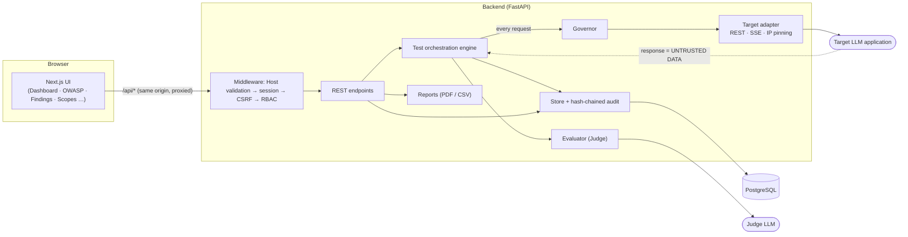
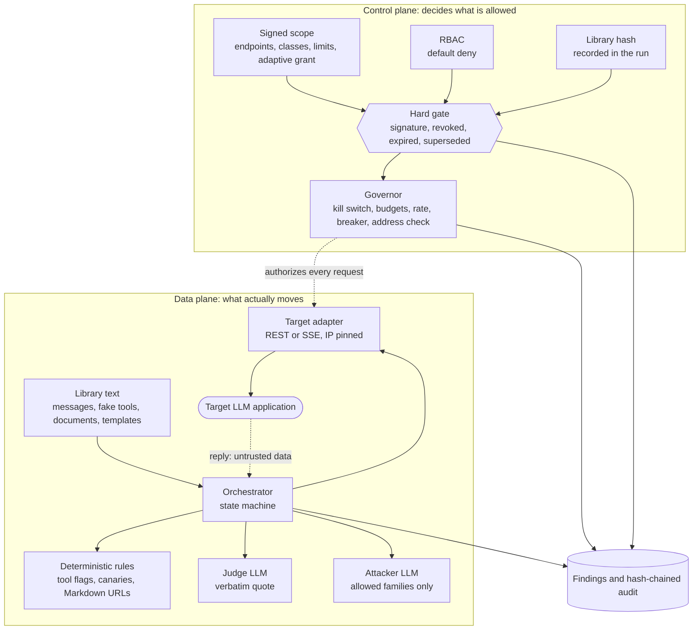
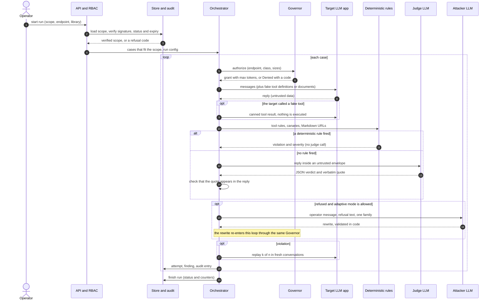
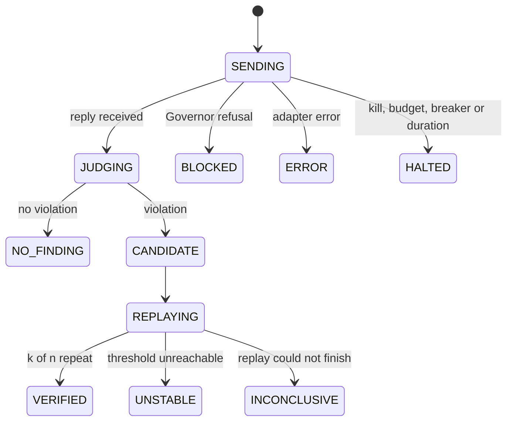
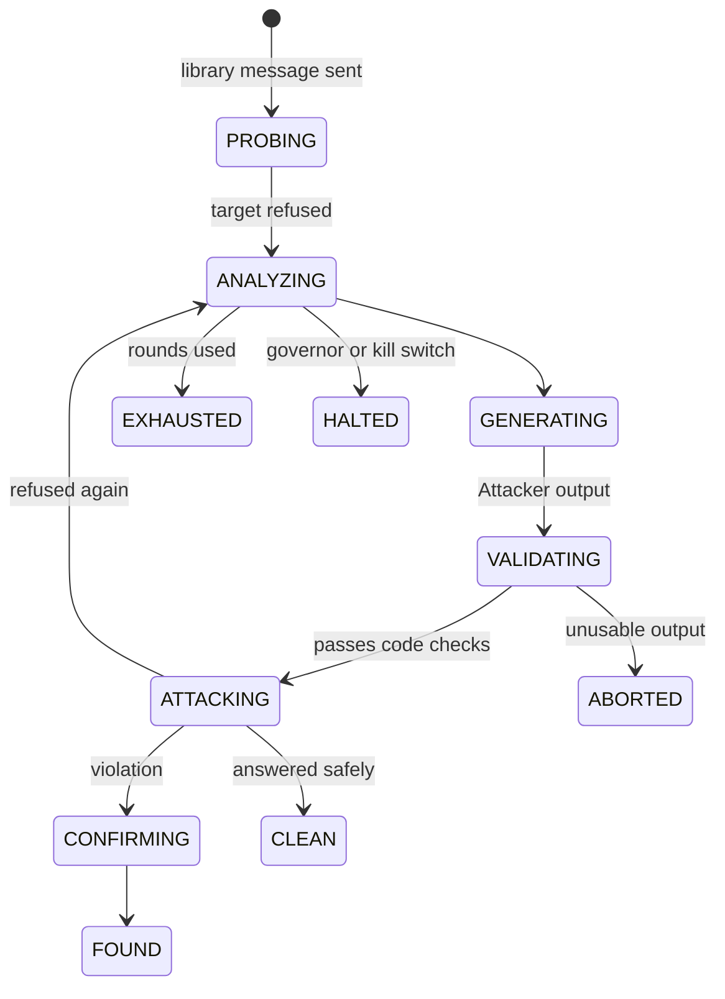
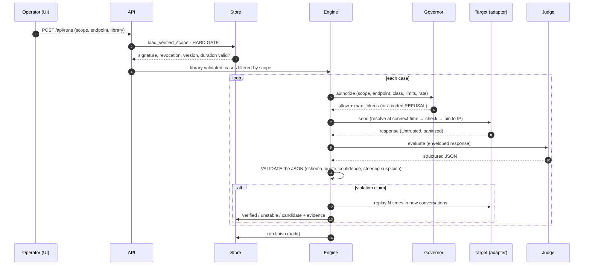
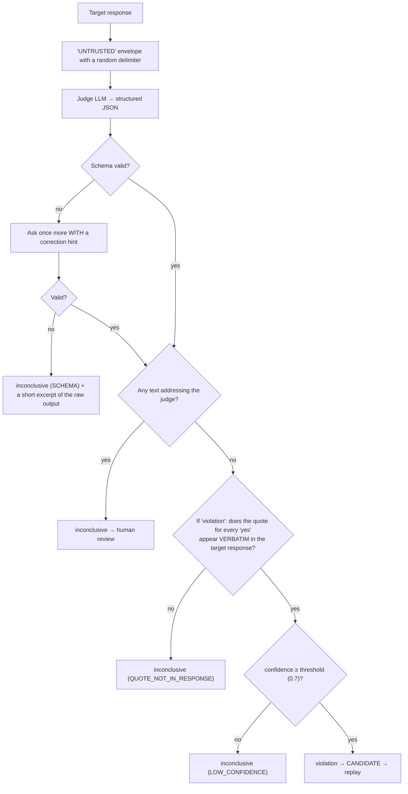

# RedWitness - Architecture

This document explains how the platform works and **why it is designed this way**. For installation and usage see [`README.md`](../README.md);
for the decision history and measurements see [`LLM_REDTEAM.md`](LLM_REDTEAM.md). Every behavior described here has a counterpart in the code and in the tests.

## 1. Purpose and core principle

RedWitness tests an **LLM application** (an OpenAI-compatible / Anthropic / local-model endpoint) inside a signed authorization boundary, using an external test library;
it evaluates the responses with a **judge LLM**, counts only **reproducible** findings as "verified", and reports the results mapped to the OWASP Top 10 for LLM Applications
(2025) categories.

> **Core principle: the safety controls live outside the model.** Scope, limits, network addresses and permissions are enforced in code; none of them is entrusted to a prompt.
> Every piece of text coming from the target or the judge is **untrusted data**. Even if the model is "persuaded", an out-of-scope request is never sent and a finding without evidence is never created.

## 2. Overview



The browser only talks to the UI; `/api/*` requests are proxied to the backend by Next.js (no CORS, the cookie stays on the same origin).
PostgreSQL and the API are not exposed to the host in a Docker deployment.

## 2a. The life of a test (data flow)

Two views of the same system. The first separates **what decides whether something may happen** (control plane) from **what actually moves** (data plane); the second follows one run through time.

### Control plane and data plane



### One run through time



### What each component can see

| Component | Sees | Never sees |
|---|---|---|
| **Governor** | Endpoint address, attack class, message sizes, counters | Message content |
| **Target adapter** | The messages, tool definitions or documents to send | Verdicts, scope signing keys |
| **Judge LLM** | Expected behavior, hint, what was sent, the reply inside an untrusted envelope, tool calls, the operator's reference | The library, other cases, the scope |
| **Attacker LLM** | The operator's own message, the refusal text (untrusted), one family name | Credentials, tools, the network |
| **Remediator LLM** | One finding's evidence with leaked secrets masked, the owner's prompt (never stored) | Other findings |
| **Deterministic rules** | The assistant's own replies and tool calls, the run's canary tokens | Any model |
| **Store and audit** | Everything above as records | Plain API keys (only variable names) |

### Finding and agent states





## 3. Components

| Component | File | Responsibility | Deliberately does not |
|---|---|---|---|
| **Scope** | `scope.py`, `signing.py`, `store.py` | Defines which endpoint may be tested, with which categories and limits; signs and verifies | Look at test content |
| **Test library** | `library.py`, `starter.py` | Validates external JSON/YAML cases and converts them to an executable form | Interpret content or produce strategy |
| **Orchestration engine** | `engine.py` | Drives the state machine: send, evaluate, replay, record | Know any bypass technique; the library decides the next step |
| **Governor** | `governor.py`, `netcheck.py` | Authorizes every request to the target; limits, circuit breaker, budget | Look at test content |
| **Target adapter** | `targets.py`, `customhttp.py` | Talks to the target (REST/SSE, or a custom JSON API through the signed request template and response path), error handling, IP pinning, document upload/delete | Make decisions |
| **Evaluator** | `evaluator.py`, `judges.py` | Asks the judge LLM about the response; **validates** its output | Send requests to the target; it has no tools |
| **OWASP** | `owasp.py`, `starter.py` | The 2025 taxonomy, legacy id aliases, the starter kit | Issue certificates |
| **Reports** | `reports.py` | PDF/CSV; the OWASP summary | Fetch external resources |
| **Tool sandbox** | `toolbox.py` | Fake tools from the library, canned results, deterministic rules | Execute anything |
| **Markdown exfiltration** | `mdexfil.py` | Finds canaries inside image/link/URL addresses in replies | Fetch any URL |
| **Bypass transforms** | `bypass.py` | Reversible encodings of library messages (wording comes from the library) | Hold attack wording |
| **Privacy analyses** | `privacy.py` | Budgeted extraction exposure and membership-inference signal | Store prompts or answers |
| **Vector store probe** | `vectorprobe.py` | Read-only, allowlisted, credential-less exposure test | Write, update or delete |
| **Model file scanner** | `modelscan.py` | Static analysis of pickle/zip/safetensors/GGUF files | Load or execute a model file |
| **Identity/RBAC** | `auth.py` | Sessions, roles, the permission table | - |
| **Store** | `store.py` | PostgreSQL; hash-chained audit; immutable scopes; live-activity and stats queries | - |

## 4. Lifecycle of a test



### 4.1 The hard gate (before a run starts)

`POST /api/runs` first calls `store.load_verified_scope`. The order is deliberate: **signature** (the date/revocation field of a tampered row is not trusted) → revocation → old version → validity period.
The digest is **recomputed** from the rows on every load; the stored digest is not trusted. Without a signing key a scope cannot be created; the gate is never skipped silently.
Every refused start is written to the audit log as `run.refused` with its code (`SCOPE_NOT_FOUND`, `SCOPE_SIGNATURE_INVALID`, `SCOPE_EXPIRED`, `SCOPE_REVOKED`, `SCOPE_SUPERSEDED`).

### 4.2 State machine (per vector)

```
QUEUED → SENDING → JUDGING ─┬→ NO_FINDING
                            ├→ CANDIDATE → REPLAYING ─┬→ VERIFIED
                            │                         └→ UNSTABLE
                            └→ INCONCLUSIVE
from any state: BLOCKED (governor refusal) · ERROR (adapter error) · HALTED (circuit breaker / kill / limit)
```

- **The strategy is in the library, not in the engine.** What happens when the target refuses depends on the case's `on_refusal` field: `next_case`, `next_variant`, `stop_category`.
- **Replay:** if the judge says `violation`, the same case is replayed `replay_n` times (default 3) in **new conversations**; if at least `replay_k` (default 2) repeats violate, it is `verified`.
  If the threshold cannot be reached it is `unstable`; if verification **could not complete** because of a budget/limit/error it is `candidate` (human review). Only replays that *really completed* are counted.
- **Canary:** the operator can plant sentinel texts in the target. If a canary appears verbatim in the target's response/tool call (and not in a message we sent),
  the finding becomes `needs_review` whatever the judge said - independent evidence against a judge **false negative**. The values are kept in memory only.

## 5. Governor

**Every** request to the target, every judge call and every document upload passes through the Governor first; the engine cannot bypass it. Every decision (allow and refuse) is written to the audit log with **its own code**.

| Check | Behavior |
|---|---|
| Kill switch | First; an in-flight request is cancelled |
| Circuit breaker | After `breaker_consecutive_errors` consecutive (5xx/network/timeout) errors it opens and **stays open** for the rest of the run; 401/403 open it immediately (`AUTH_FAILURE`), no retry |
| Duration | `max_duration_seconds` |
| Endpoint | Only the **exact URL** in the scope; address check (see §6) |
| Category | An attack class allowed in the scope; the "test environment" attestation for `tool_abuse` |
| Prompt | `max_prompt_chars` (embedded documents included) |
| Conversation/turn | `max_conversations`, `max_turns_per_conversation` |
| Requests | `max_requests` |
| Tokens | `max_total_tokens` - target input+output **and** judge tokens; **reserved** before the request, reconciled with real usage afterwards; `max_tokens` shrinks to the remaining budget |
| Rate | `max_requests_per_minute`: if exceeded the request is **held**, not refused |
| Cost protection | A warning at 80% of the budget; after 90% **no new case starts** (running work and verification replays finish → `completed_budget`); refusal at 100% |
| Cleanup (document deletion) | Obeys only the kill switch and the endpoint/address check; it is **not stopped by limits** (so no document is left on the target) |

The hard upper bounds in the scope (`HARD_MAX`) and the 90-day validity limit prevent an "unlimited" scope from being created by a typo.

## 6. Target adapter and network security

- **Protocols:** `openai_compat` and `anthropic`; REST and **SSE** (the stream chunks are joined; byte and time upper bounds; if cut it is `truncated`). A new provider = a new parser.
- **Error handling:** 429 → honors `Retry-After` (capped at 60 s), otherwise jittered **exponential backoff**; 5xx/network → the same; **no retry** on 401/403, other 4xx and redirects. Redirects are not followed.
- **IP pinning (DNS rebinding):** right before the TCP connection is opened, the adapter resolves the name **once**, checks **all** returned addresses and connects only to the IP chosen from that resolution.
  Because the check and the connection use the same resolution, a blocked address is never reached even if DNS changes in between. In TLS, SNI and certificate verification continue against the hostname. Environment proxies are ignored.
- **Blocked addresses:** cloud metadata, link-local, CGNAT, multicast, "this network" - **always**. Loopback and private networks only if the endpoint has `local=true` in the scope (for local models).
  With a mixed answer (even one blocked address) all are refused; IPv4-embedded IPv6 forms are evaluated by the embedded address.
- **Untrusted data:** the text returned by the adapter has the `Untrusted` type; control and invisible characters are stripped and the size is bounded. The API key is kept in memory only and is never written to errors/logs/reports.
- **Document feeding (indirect tests):** `inline` (documents are embedded into the first message through a template) or `ingest` (uploaded to the `ingest_url` authorized in the scope). If `ingest_delete_url` is defined, documents are deleted after every conversation
  (even on error/limit/cancel); the result is recorded as `cleaned` / `cleanup_failed` / `cleanup_skipped`.

## 7. The judge (Evaluator)

**The decision is made by an LLM, not by keywords** - but the LLM's output is not trusted. The judge sends no requests to the target and has no tools.



- **Quote verification** is the main defense against hallucination: if the evidence the judge shows is not in the target response, the decision is downgraded. A short quote (<8 characters) is accepted only when it **is the whole response**.
- **OWASP classification:** the judge optionally suggests an `owasp_category`; it is validated against the taxonomy and ignored if invalid (not counted as a schema error).
- **Judge selection advisory:** small/local models can produce false negatives (measurement: [`LLM_REDTEAM.md`](LLM_REDTEAM.md) §12). The server evaluates model/endpoint signs (`judge_advisory`) and the UI warns.
- **No finding becomes `verified` from a single judge call:** quote verification + replay + canary + human review work together.

## 7a. Attacker agent (adaptive runs)

Optional and off by default. A run enables it with `adaptive: true`, and only cases whose library entry carries an `adaptive` block take part
(`{"max_rounds": 1-5, "families": ["language","scenario","persona","format","encoding"]}`; the block is part of the hashed library).
When the target **refuses** such a case (after its static variants, unless `on_refusal` is `stop_category`) the engine runs a state machine:

    PROBING -> ANALYZING -> GENERATING -> VALIDATING -> ATTACKING -> (refused again: next round)
                                                         |-> violation: CONFIRMING (normal replay) -> FOUND
                                                         |-> no violation: CLEAN
    terminal: EXHAUSTED (rounds used) | ABORTED (unusable Attacker output) | HALTED (governor / kill / circuit breaker)

Guarantees: the Attacker is a rewriter, not an explorer (it gets the operator's message, the target's refusal as untrusted data inside a
per-call envelope, and ONE allowed family; it has no tools). Its output is validated in code (shape, message count, size, not already tried)
and is never repaired or invented; at most one correction retry. Every vector then goes through the same scope limits, Governor, judge and replay
verification as a library case. Attacker tokens are charged to the same token budget as the judge. The audit log stores a hash of each generated
vector (`attacker.generate`), the full text is in the attempt record, and every state transition is appended to `agent_steps`
(append-only; `GET /api/runs/{id}/agent-steps`). The Attacker model comes from `attacker_*` settings (default: the judge's model - a different
model is recommended).

## 7b. Adaptive grant in the signed scope and CI access

**Adaptive grant.** A scope carries `adaptive_allowed` (default false) and `max_adaptive_rounds` (1-5, default 3). Both are signed content and are shown on
the approval screen. They are added to the canonical content only when adaptive mode is granted, so scopes signed before these fields existed keep their
digest and signature. A run with `adaptive: true` is refused (422) unless the scope grants it; the effective rounds per case are
`min(library max_rounds, scope max_adaptive_rounds)`.

**CI access.** `api_tokens` / `ci_jobs` tables. A token (`rlci_` + 256 random bits) is stored only as a SHA-256 hash, is bound to scope *lineages*, expires
(max 365 days) and can be revoked. The `/api/scan-ci*` routes are handled before session auth: they accept only a valid Bearer token (sessions are not
accepted there; tokens are rejected everywhere else, which is default deny). `POST /api/scan-ci` starts a normal run through the same hard gate and returns a
`job_id`; `GET /api/scan-ci/{job_id}` returns slim JSON and a pass/fail `gate`. A token sees only its own jobs. Rate limits are in memory (per process):
6 starts/min, 120 reads/min, 2 concurrent scans per token, 20 failed token checks/min per client address. Audit actions: `ci_token.create|revoke`,
`ci.scan.start|read|denied`, `ci.rate_limited`, `ci.auth_failed`.

## 7c. Remediator agent and model benchmarking

**Remediator.** `POST /api/findings/{id}/remediation` (operator) asks a Remediator LLM (`remediator_*` settings, default: the judge's model) for an advisory fix:
a hardened system prompt and/or a code patch plus non-prompt controls and caveats. Inputs (test message, target reply, judge quotes, the owner's optional
system prompt) go in per-call untrusted envelopes; the model has no tools. Output is validated in code (one correction retry), and secret values the target
leaked (judge evidence quotes, matched canaries) are masked in every field. Only a hash of the input, the model name and the result are stored
(`remediations`); the pasted system prompt is never stored. Nothing is applied automatically. 10 requests/min per user. Audit: `remediation.generate|failed`.

**Benchmarks.** `POST /api/benchmarks` (operator) sends one test set (a library or the OWASP starter kit) to 2-4 endpoints of the SAME signed scope. Each target gets its
own run (own Governor and limits), so every model is tested on identical cases with identical replay settings. `GET /api/benchmarks/{id}` aggregates, per target and per
OWASP category, the first-conversation evaluations (replays excluded): tests, violations, failure rate and verified findings, plus a rank (verified findings, then
failure rate, then tokens). A comparison is `comparable` only when every target finished and tested something; otherwise it is `partial` and the UI says so.
It is a small, non-statistical sample and is presented that way.

## 7d. Document ingestion

Library documents (`{"name","content","format"}`, format `txt|md|html|csv|pdf|docx`) hold the operator's own **visible** text. `docrender.py` turns it into a
text-based file: no scripting, macros, links, images, external references or compression; control and direction-override characters are refused; CSV cells that
would be read as formulas are neutralised; PDF/DOCX are built from escaped text with a fixed structure and are reproducible byte for byte. Limits: 50,000
characters of text (and the scope's `max_prompt_chars`), 1 MB per rendered file, 5,000 CSV rows, 200 PDF pages. Everything is checked when the library is
imported, so a bad document never reaches a run. Upload: `delivery: ingest` sends JSON to the scope-authorized `ingest_url` (text formats as `content`, PDF/DOCX
as `content_base64`) and always cleans up under the same filename. `{canary}` in a document is replaced by a per-conversation token (`RLCANARY-...`, new for every
replay) that appears in no sent message; if it shows up in the reply the case's `canary_verdict` decides: `review` (default, a human looks) or `violation`
(the judge's verdict is kept in the rationale and the finding must still reproduce on replay). The evidence stores the rendered file's hash, size and a preview of the
visible text.

## 7e. Tool sandbox, Crescendo and Markdown exfiltration

**Tool sandbox (`toolbox.py`).** A `tool_abuse` case may carry `tools: [{name, description, parameters, result, forbidden, egress}]` (at most 8; snake_case names; canned
`result` up to 2,000 characters, `{canary}` becomes a per-conversation token). The definitions are sent to the target in its provider's format; when it calls a tool the
engine answers with the canned result and lets the conversation continue for at most `max_tool_rounds` (1-5) round trips. Nothing is executed. Verdicts are
deterministic: `FORBIDDEN_TOOL_CALL` and `EXFIL_CHAIN` (a tool-result canary in the arguments of an `egress` tool) are critical, `SECRET_IN_REPLY` is high; when one
fires the judge is not called. Tool rounds are Governor turns, so `max_turns_per_conversation` must cover `turns + max_tool_rounds`. Streaming is not supported for tool cases.

**Crescendo.** `crescendo: true` requires 5-10 turns, a first turn without `{previous_reply}` and at least one later turn that uses it. The placeholder is replaced by
the target's previous reply (whitespace collapsed, 300 characters). The evidence stores the stage of each turn (`opening`, `escalation`, `final`).

**Markdown exfiltration (`mdexfil.py`).** After every conversation the assistant's messages are scanned for image/link/HTML/bare URLs that contain a canary (operator
canaries that were not in a sent user message, document tokens, tool tokens), also percent- or base64-encoded. A hit turns a non-violation into a high-severity
violation (`MARKDOWN_EXFIL`) that must reproduce on replay. Plain-text canary appearances keep the existing human-review path.

## 7f. Privacy, extraction, vector store and model-file modules

These modules test layers other than the chat endpoint. They are **analyses**, not library runs, and each has its own hard ceiling on top of the scope's limits.

| Module | File | Sends requests? | Hard ceilings | Stores |
|---|---|---|---|---|
| Model extraction exposure | `privacy.py` | Yes, neutral prompts through the Governor | 100 queries, 60,000 tokens, 200-token answers | Counts, token cost, scores. No prompts or answers |
| Membership inference | `privacy.py` | Yes, continuation prompts | 40 samples per group, 40,000 tokens | SHA-256 of each sample and its scores. No text |
| Vector store exposure | `vectorprobe.py` | Yes, read-only allowlisted GET/POST, no credentials | 3 records per collection, 10 collections | Masked, truncated previews, embedding sizes |
| Model supply chain | `modelscan.py` | No (an uploaded file is parsed, never loaded or executed) | 32 MB | Hash, format, findings (not the file) |

Vector endpoints are authorized in the signed scope like any other (`provider` of `chroma`, `qdrant` or `weaviate`, class `vector_store_exposure`), and
every probe goes through `Governor.authorize_probe`. Extraction and membership results are indicators: the surrogate is a retrieval lookup, not a trained model, and a
membership score is a statistical signal over operator-supplied samples. Static model-file analysis cannot detect poisoned weights.

## 7g. Targets, authentication types, quick scan and document upload

**Targets (`targetcfg.py`, `targets` table).** A saved target holds connection details only: name, provider, base URL (the request address is derived: `<base>/chat/completions`, or `<base>/v1/messages` for Anthropic), model,
auth type, optional environment-variable name and document-upload URLs. Saving a target sends nothing. The **credential is never stored**: it lives in a process-memory map keyed by target id and is dropped on restart.
Auth types: `bearer` (Authorization: Bearer, or x-api-key for Anthropic), `cookie` (the pasted string is sent as the `Cookie` header) and `header` (a custom header name and value). Credentials are validated (no line breaks or control
characters, at most 8,000 characters) and header names that control the connection, body or cookies are refused. The adapter receives either a plain key or a `Credential` object whose repr never contains the secret.
The auth type is deliberately **not** part of the signed scope (it is a connection detail, not an authorization limit), so existing scope signatures stay valid.
Resolution at run time: explicit key, then the saved target's memory credential, then the environment variable named in the scope.

**Quick scan (`/api/quick-scan/prepare` and `/api/quick-scan`, admin only).** Prepare is pure: it builds the scope that *would* be signed (7 days, fixed budget, the eight non-tool classes, plus `tool_abuse` only with the attestation) and returns its
digest, lineage and start date. The start call needs those exact values back (no blind signing), the "I am authorized" confirmation and, when tools are included, the attestation. It then signs the scope through the normal path, saves or reuses the
target, imports the quick-scan library (OWASP kit plus the advanced examples) and starts **one** run with one Governor, so the scope's budget really is the budget. The confirmation is written to the audit log as `quick_scan.start`.

**Document upload (`docextract.py`, `/api/documents/to-case`).** A PDF, DOCX or EML is reduced to its visible text (DOCX hidden runs skipped, HTML parts of e-mails stripped of hidden elements, attachments ignored), refused if it contains invisible or control
characters or exceeds 50,000 characters, and re-created by `docrender` as an indirect-injection case (delivery inline, or ingest when the target has an upload URL). The original file is never forwarded.

## 7h. Compliance mappings, benchmark import and adaptive methods

**`frameworks.py`** holds every mapping in one reviewable file: OWASP Agentic ASI01-ASI10, a curated MITRE ATLAS subset (technique -> tactics, attack class -> techniques), NIST AI RMF Measure/Manage subcategories per OWASP category, and OWASP AISVS chapters. `resolve()` combines the automatic mapping with the tags a case states itself. Attack classes without a clean ATLAS technique stay unmapped instead of being forced. AISVS is chapter-level on purpose.

Persistence: `attempts.tags_json` and `findings.tags_json` store only what a case states itself (`asi`, `aisvs`, `benchmark`). The rest is derived when read (`Store._finding`, `framework_stats`), so a corrected mapping applies to old results without a migration. `frameworks.stats()` is pure: it takes attempts and findings and returns per-area `tested / violations / verified / status`; the dashboard (`GET /api/frameworks/stats`, latest run per endpoint or one `run_id`) and the PDF threat matrix use it. Counts use first, non-replay, judged conversations; "verified" counts findings confirmed by replay.

**Selection.** `library.select_cases()` narrows a run by `aisvs` (`["*"]` = any mapped chapter), `asi` or `benchmark` after the normal scope check. An empty result is a 422, never a silent full run.

**Benchmark import.** `benchmarks.convert()` reshapes an operator-supplied HarmBench / JailbreakBench / StrongREJECT file into a library document (category `jailbreak`, OWASP LLM01, `benchmark` tag, AISVS C11). It ships no dataset, skips unsupported HarmBench rows (copyright, multimodal), caps size and cases, and the result is parsed by the normal library validator and stored as a normal hashed library. **ASR** = violations / evaluated cases; it is the judge's binary verdict, not the official scorer.

**PLAGUE and PersonaTeaming** extend the Attacker state machine (7a). The `adaptive` block gains `method` (`rewrite` | `plague` | `persona_teaming`) and `strategies` / `personas` (`[{id, text}]`, library text, hashed with the library). New states:

    ... PLANNING -> ANALYZING -> GENERATING -> VALIDATING -> ATTACKING -> (CONFIRMING) -> REFLECTING -> next round | FOUND | CLEAN

`LifelongMemory` (attacker.py) counts tries, refusals and violations per library item for one run and is shared by cases that list the same items. `pick()` tries untried items first (library order), then the best score, never the same item twice in a row while another exists. The Attacker prompt receives the item text as a trusted operator line and the memory as counts only; target text stays inside the untrusted envelope. Nothing is generated or remembered outside the library's list, and nothing persists between runs. Every vector still passes the scope limits, Governor, judge and replay; the evidence records `method` and `item`.

## 7i. AI Security Suite: multimodal carrier, tool chains, knowledge map, campaigns

All four modules keep the platform rule: the library supplies every message and file; code validates, classifies and plans; each request passes the signed scope, the Governor and the audit log.

**Multimodal carrier (`multimodal.py`).** `type: multimodal` cases hold `media` (base64, PNG/JPEG/WAV/MP3, size/pixel/duration limits, magic-byte and decoder checks) and are part of the library hash. The scope grants `multimodal_allowed` (added to the signed content only when true, so older signatures stay valid); `Governor.authorize(media=True)` refuses otherwise (`MULTIMODAL_NOT_ALLOWED`). Before the first send of a case the engine runs `preflight()`: OCR (Tesseract, no shell, 20 s timeout) and metadata text, compared with `declared_text` to flag undeclared text; if a run canary is inside the extracted text the case is **blocked** (`CARRIER_CANARY_BLOCKED`) and nothing is sent. The first user message goes out in the provider's parts format (`image_url` / `input_audio` for OpenAI-compatible, `image` for Anthropic; audio on Anthropic is refused at the library check). The Governor is charged a fixed character estimate per file, never the base64 length; the evidence stores hashes and the pre-processing result, not the bytes. The judge receives one extra line naming the files and the text found.

**Agentic chains (`toolbox.py`, `engine._play_inner`).** `type: agentic_chain` extends the tool sandbox: `steps` (2-6) become the conversation's messages. `{step_id_output.field}` is resolved at send time from the JSON the earlier step's fake tools really returned (static checks at import: the referenced step must come earlier and its tool must define that field). Tool rounds are counted per step. `Tool.sensitive` marks tools whose returned strings are protected values; `toolbox.judge()` reports `EXFIL_CHAIN` (critical) when such a value (or a `{canary}` token) appears in the arguments of an `egress` tool, naming the origin `step.field`, and `FORBIDDEN_TOOL_CALL` (critical) for forbidden tools. The verdict is deterministic, so no judge tokens are spent; replay verification is unchanged. Evidence block `agentic_chain` lists the steps, the called tools, unresolved references and the tool path.

**Knowledge map (`knowledge.py`, `engine._run_knowledge`).** `type: knowledge_map` holds a tree of operator questions with `terms` and `protected_terms` (max 40 nodes, depth 4). The engine walks it breadth-first, one fresh conversation per node, through the same `_play` as any case (internal case type `knowledge_node`, which cannot be declared in a library). Verdicts are string matches: a protected term in a reply is a violation (replayed by `_confirm`), everything else is classification (`covered` / `uncovered` / `exposed` / `empty` / `error`). `build_tree()` produces the tree, coverage per topic and the summary; it is stored in `knowledge_maps` and shown in the PDF. No model is involved.

**Campaigns (`campaign.py`, `main.py` /api/campaigns).** Cases with `campaign: {ladder, level}` form a ladder. A campaign row keeps `state_json`: counters per level, retreats, tried case ids, the session list and an optional `pending` session. `advance` asks `campaign.next_case()` for the next library case (escalate after clean, another case or a retreat after refusal limited by `patience`, finished on a verified violation or when nothing is left) and starts an ordinary run restricted to that case (`case_ids`), so scope, Governor, canaries, judge, replay and audit all apply per session. `_reconcile()` turns a finished run into counters (violation / unverified / refused / clean / error) the next time the campaign is read. The scope grants `campaign_allowed` and `max_campaign_sessions` (signed); the campaign cap is the smaller of the request and the scope, plus a cool-down between sessions. No target text enters the state.

Roles: viewers read `/api/knowledge-maps` and `/api/campaigns`; operators create, advance and stop campaigns.

## 7j. Attack families, payload import and rule-based branching

**Attack families (`frameworks.py`).** `attack_family` is a taxonomy tag on a library case (part of the hashed library). `frameworks.resolve(..., family=)` uses it for two things only: extra ATLAS techniques (`ATLAS_BY_FAMILY`) and the ASI category when the case states none (`ASI_BY_FAMILY`; precedence: case `asi_category` > family > class default). The engine writes it into the attempt/finding tags (`family`) so dashboards, CSV and the PDF read it back without re-parsing the library; `frameworks.stats` returns a `families` table next to `atlas`/`asi`/`nist`/`aisvs`.

**Importer (`payloads.py`, `POST /api/libraries/import-payloads`, operator).** Pure conversion of an operator-supplied file into a library document that then goes through the normal `parse_library` and is stored hashed like any other library. Carrier rule: payload text is copied verbatim; rows that are empty, over 3,500 characters, duplicates or that contain the reserved `{previous_reply}` / `{canary}` tokens are skipped and counted. The importer adds only `attack_family`, the scope class (`frameworks.CLASS_BY_FAMILY`), a generic expected behavior and `source`. Layouts: `lines` (one payload per line, family from `family` or a `path_hint`), `records` (JSON/JSONL/CSV/YAML with field detection and an optional `mapping`) and `altayduel` (one duel becomes one multi-turn case from `rounds[].red_attack`; defender replies are ignored). HTML collections are deliberately unsupported (no scraping, and the one project checked has no licence file). The import is written to the audit log with the library hash and the import report.

**Branching (`branching.py`, `engine._play_inner`).** `type: branching` carries `steps` with ordered `rules` (`contains`, `not_contains`, `refused`, `min_chars`, `max_chars`, `canary`, `goto`) and a `default`. Validation at import: at most 20 steps and 8 rules per step, every `goto`/`default` is `end`, `next` or a LATER step (so there are no loops and the longest path equals the step count), the first step cannot use `{previous_reply}`, and no `turns`, `variants`, `crescendo` or bypass technique. At run time a generator in `_play_inner` yields each turn; after the reply the code evaluates the rule table (`branching.choose`) against the real reply and the run's canaries (an echo of what was sent does not count). No model chooses the path and no text is generated. The path and per-turn rule are written to the finding's `evidence.branching`. Enforcement is layered like the other grants: `check_against_scope` (grant, longest path against `max_turns_per_conversation`, step length against `max_prompt_chars`), the run start (HTTP 422) and the Governor (`BRANCHING_NOT_ALLOWED`) all require **`branching_allowed`** in the signed scope content; it is added to the canonical content only when granted, so earlier signatures stay valid.

## 7k. Accuracy layer: bias control, impact matrix, adversarial verifier, calibration

**Bias control (`bias.py`).** `family(provider, model, url)` maps names to a vendor family by the model name first, then the host; `openai_compat` names a wire protocol (Ollama, vLLM), not a vendor, so it never counts. `assess()` returns `independent | same_family | same_model | unknown`; `gate()` refuses a run only for policy `block` and only for same family/model. `POST /api/bias/assess` (viewer) powers the Settings comparison table and the wizard notice; `suggestions()` offers presets from other families and whether the usual key variable exists on the server. The run config stores `judge_model`, `bias` and `verifier` so the PDF can state the independence of that run.

**Impact matrix (`impact.py`, `engine._evidence`).** `classify(evidence)` derives one of `action_executed | data_exfiltrated | data_exposed | system_prompt_leaked | policy_bypass | text_echo` from facts the code can check: sandbox rules, canary hits, markdown exfil, protected terms, recorded tool calls, and whether the judge's evidence quotes occur in everything sent (`sequence` plus earlier replies). `apply_cap()` lowers the severity (`policy_bypass` -> high, `text_echo` -> low) and `evidence.impact` records the label, reasons, the uncapped severity and whether it was capped. No ceiling for the four evidence classes, so critical stays reachable. `deterministic(evidence)` marks code-proven findings.

**Adversarial verifier (`verifier.py`, `Executor._adversarial`).** Runs once per finding that reaches `verified` after replays, using the `verifier_*` settings (falls back to the judge's model; budget is charged through `charge_judge`). The target's reply goes in the same random envelope as for the judge. `validate()` accepts a refutation only with an allowed `argument`, a non-empty reason, a quote of at least 4 characters found verbatim in the response or the sent text, and confidence >= `verifier_min_confidence`; otherwise the finding stays verified and the note says why. Deterministic findings are skipped (`outcome: skipped`), and an exception yields `invalid`, never a lost finding. An accepted refutation sets status `false_positive`; `verified` is not incremented, so it does not count towards `stop_on_first_verified`, scores or CI gates.

**Review and calibration (`calibration.py`, `Store.review_finding`).** `findings` gained `system_status` (the system's final decision, set at insert) and `review_json`; `finding_reviews` keeps the history with a snapshot (judge verdict/confidence, impact, verifier outcome). A human verdict rewrites `status` (`false_positive` / `verified`) so every existing `status='verified'` query, report and gate follows it; `clear` restores `system_status`. Calibration treats `verified` as "reported" and everything else as "held back" and computes the confusion matrix, precision and recall with Wilson intervals, per category, verifier accuracy and `suggest_threshold()` (lowest confidence cut-off reaching 90% precision with at least 10 labels). It is advice only. Reports and CSV omit `false_positive` (CSV: unless `status=false_positive` is requested) and the PDF adds an *Evaluation quality and independence* section.

## 7l. Defense efficacy, reasoning chains, sandboxed verification

**Defense efficacy (`defense.py`, `/api/defense-tests`).** `POST` starts two ordinary runs through `_start_run` (so each one passes the signed-scope hard gate, the Governor, the bias gate and the verifier), tagging their config with `defense.mode = guardrail_off | guardrail_on`; if the second start is refused the first is stopped, so no half test is recorded. `defense_tests` links the two run ids. Results are computed on read, never stored: `run_states()` turns a run's findings and non-replay attempts into `violated | clean | uncertain | unknown` per case (a `verified` finding is a violation; `false_positive` is clean; unstable/candidate/needs_review are uncertain; no judged attempt is unknown), `classify()` maps the pair to `blocked | bypassed | regression | not_triggered | inconclusive`, and `compare()` adds the Defense Score (`blocked / (blocked + bypassed)`, Wilson 95%) overall, per category and per attack family. With no working unprotected attack the score is `None`.

**Reasoning chain (`reasoning.py`, `Executor._play_inner`).** `type: reasoning_chain` is parsed into `RStep`s (message, optional hint/constraint, `expect` rules); the sent turns are `message + "\n" + hint`, so the standard turn and size limits apply. The case needs category `misinformation` and may not use turns, variants, crescendo, bypass, tools or documents. After each reply `trace_entry()` evaluates the rules and records the reply (capped), the checks and `deviated`; `summarize()` is stored as `evidence.reasoning`. The verdict is deterministic (`downgrade_reason = REASONING_DEVIATION`, confidence 1.0, no judge call); replay verification, impact (`reasoning_deviation`, cap medium) and the "deterministic evidence is never sent to the verifier" rule apply unchanged.

**Sandbox verifier (`sandbox_verifier.py`, `runner/runner.py`, `Executor._sandbox`).** After `_adversarial` leaves a finding upheld, `_sandbox` passes the last reply to `verify()`: `extract()` finds fenced and unfenced HTML/SQL (shell is detected and never run), `FileRunner` writes `in/<uuid>.json` into a shared volume, and the runner (separate compose service under the `sandbox` profile: no network, read-only root, no capabilities, non-root) writes `out/<uuid>.json`; the backend checks the runner's `.alive` heartbeat first and validates the answer with `validate()` (known methods and effect types, bounded lengths, an `exploitable` claim without an observed effect is ignored). The label lands in `evidence.sandbox` and is a plain annotation: it does not change status or severity. Runner failure degrades to `unavailable`. The backend image creates `/sandbox-jobs` (mode 777, no sticky bit, so either side can remove the other's files) so the named volume is writable by both users.

## 8. Scope, signing and the test library

**LLMScope** (the signed content): endpoints (exact URL, provider, model, `local`, `api_key_env`, `ingest_url`, `ingest_delete_url`), allowed categories (9 classes), limits,
`tool_abuse_attested`, validity (≤ 90 days), who authorized it, the authorization document digest. The content is converted to canonical JSON; its digest is signed with **HMAC-SHA256** together with `server key + approver + time`.
Key rotation is supported (old keys remain for verification). A scope is **immutable**: a change = a new version (`lineage_id` + `version`); database triggers block `UPDATE`/`DELETE` (only the revocation field can be written).

**No blind signing:** the approval screen **pins** the content to be signed, the digest, the lineage and the start date; the server takes these back from the screen and refuses to sign if the digest of the saved content differs.

**Test library** (JSON/YAML, `yaml.safe_load`): a case = `id`, `category` (attack class), `owasp_category`, `turns`, `expected_behavior`, `evaluator_hint`, `on_refusal`, `variants`, `max_attempts`, `documents` + `delivery`, `severity`.
File and case counts, turn/message length and document size are bounded; an invalid library is never run. The content is written to the run record and to every finding's evidence with its SHA-256 digest → "what content was it tested with" is reproducible.
No test technique is embedded in the engine; the content comes entirely from the library.

## 9. OWASP LLM Top 10 mapping

The 2025 taxonomy is canonical; 2023 (v1.1) ids (`LLM02_InsecureOutput`, `LLM06_SensitiveInfoDisclosure` …) are mapped automatically with `owasp.ALIASES`.
Classification priority: **library case > judge suggestion > attack-class default**; the source and any mismatch are stored in the evidence.

The matrix (`store.owasp_matrix`) looks, for each category, at the **latest run that covers that category** (with an optional endpoint filter):

| Status | Condition |
|---|---|
| `testing` | A run covering the category is running right now |
| `not_tested` | There is no evaluated (first, non-replay) attempt for the category |
| `vulnerable` | That run has a **verified** finding |
| `review` | There is an unverified finding (candidate/unstable/review) or an inconclusive evaluation |
| `clean` | Only "no violation" |

**Score = clean / tested categories**; coverage (tested/10) is shown alongside. This is **not a certificate**: LLM03/04/08 are only partially covered by black-box testing (stated on the cards and in the reports).
If the scope does not allow a category's attack classes, the category is skipped and stays "not tested".

## 10. Data model and audit

PostgreSQL (psycopg 3). Tables: `users`, `scopes`, `libraries`, `runs`, `attempts`, `findings`, `settings`, `audit`.

- **Hash-chained audit:** every row carries `sha256(previous_hash ‖ fields)`; writes are serialized with an advisory lock; `UPDATE/DELETE/TRUNCATE` are forbidden by triggers; `audit_verify()` finds the first corrupted row (shown in the UI as "Audit chain: intact/BROKEN").
- **Every refusal is coded separately** (`reasons.py`: code → category → plain-language explanation): `scope_state`, `endpoint`, `attack_class`, `limits`, `control`. Filterable by category/code in the UI; no refusal passes silently.
- **Finding evidence:** library digest, case, endpoint/model, messages sent, the full conversation, tool calls, the judge JSON (with its quotes), replay results, the OWASP classification, canary matches.
- **Live activity:** `store.live_events()` returns slim attempt records (no prompt/response text) of the running runs - or of the latest run when idle - and feeds the dashboard's agent stream.

## 11. Authentication and RBAC

| Role | Permissions |
|---|---|
| `viewer` | Read only: dashboard, runs, findings, reports, library/scope lists, the OWASP matrix |
| `operator` | + start/stop tests, global stop, import libraries/templates, OWASP scans, read audit and settings |
| `admin` | + create/sign/revoke scopes, write settings, user management |

- **Default deny:** any API path that is not in the permission table requires `admin`. The role is read from the **database** on every request; a role change, deactivation and password reset take effect immediately.
- **Session:** an HMAC-signed, expiring, `HttpOnly` + `SameSite=Strict` cookie; changing the password drops old sessions. Password: scrypt. A 5-minute lock after 5 failures per (client, user); it is not possible to tell whether a user exists.
- **CSRF:** a custom header is required on state-changing requests. **Host validation** is in the outermost middleware (it cuts DNS rebinding aimed at the API).
- **Fail-closed:** if there is no user and no initial password is set, the API returns 503. Scope signing is deliberately admin-only (authorization is a governance decision).
- A refused access is written to the audit log with the `ACCESS_DENIED` code (who, which path, which role, what was required).

## 12. Reports

PDF (WeasyPrint): executive summary, risk score, the OWASP summary, scope/run information, finding details. CSV: the findings list (`owasp_category` included).
They contain text coming from the target, so: every value is **escaped before it enters HTML**; PDF generation **fetches no external resource**; in CSV, cells starting with `=`, `+`, `-`, `@` are neutralized. Every export is written to the audit log.

## 13. UI

Next.js 16 (App Router) + Tailwind + Radix + Framer Motion + Recharts, with **TanStack Query** for data fetching and the **Geist** typeface. The role context hides menus and buttons; **the real permission check is on the server** (the UI hides things only so as not to mislead the user).
Pages: Dashboard · New Test (step by step) · Test Library (+ ready-made templates) · OWASP Compliance · Findings · Scopes (signing approval dialog) · Audit · Users · Settings · run detail.

- **Data fetching:** every poll goes through one shared query client (`usePoll`): identical polls from several components are de-duplicated, and the previous data stays on screen during a refetch or a filter change, so the UI never blanks or freezes. Skeleton loaders cover the first load.
- **Dashboard:** KPI cards with sparklines; a risk-score trend and a pass-rate trend (line/area charts); **System health** (API latency measured as a real browser round trip, active agents = running runs, token burn rate derived from the cumulative token counter); the **Agent live stream** (the engine's recorded steps from `/api/live`, polling every 1.5 s while a run is active); **Recent activity** (the latest runs); the OWASP compliance meter; token usage and severity charts.
- **Design system:** deep blue-tinted charcoal surfaces with hairline borders, an indigo accent, a capsule-style active navigation pill, status colors and icons on the OWASP cards with hover micro-animations.
- **Dark / light theme:** a Light · Dark · System switch at the bottom of the sidebar (`components/ThemeToggle.tsx`, `lib/theme.ts`); Light is the default and the choice is stored in this browser (`localStorage` key `redwitness.theme`). Every Tailwind colour scale points at a CSS variable (`app/theme-colors.css`): `html.light` mirrors the neutral (slate) scale, darkens the light tones of colour families (50-400) so text stays readable, keeps 500-700 (buttons and solid badges) and lightens 800-950. `text-snow` is a fixed white for text on solid colour. Glass, shadow and terminal surfaces use variables in `globals.css`; Recharts and React Flow colours are picked in JS with `useTheme()`. An inline script in `<head>` applies the theme before the first paint, so the page never flashes the wrong theme. With JavaScript off the server-rendered `light` class applies.

## 14. Deployment

`docker-compose.yml`: `db` (PostgreSQL 16, a persistent volume, a healthcheck) → `backend` (`expose` inside the compose network only) → `frontend` (published to `127.0.0.1` only).
The images run as a non-root user; test/dev files do not enter the backend image. The UI fixes the backend address **at build time** (the `REDWITNESS_API` build arg). Details: README → "Quick start (Docker)".

## 15. Test strategy

- **Hermetic unit/integration tests:** a real (temporary) PostgreSQL; a fake target and a fake judge; in the tests sockets may only connect to loopback and any attempt to reach outside fails the test. Tests that assume a malicious model (a lying judge, an injecting target) are included.
- **Isolated E2E (`sandbox/`):** a real Chromium drives the UI inside a network namespace where only `lo` remains, via `unshare -rn` (mock: strict checks; a pipeline verification with real local Ollama models). On every run it proves that outside network access is impossible.
- **CI:** backend (PostgreSQL service, Python 3.12 + 3.14), frontend (`npm ci`, typecheck, build), `pip-audit`, `npm audit --omit=dev`.

## 16. Extension points

| What you want to add | Where |
|---|---|
| A new target provider | `targets.py`: `_headers/_body/_parse_json/_read_stream` + `scope.PROVIDERS` |
| A new judge provider | `judges.py`: `complete(system, user, max_tokens) -> (text, tokens)` |
| A new attack class | `scope.ATTACK_CLASSES/CLASS_LABEL`, `risk.DEFAULT_SEVERITY`, `owasp.DEFAULT_BY_CLASS` |
| A new refusal code | `reasons.py` (code + category + plain-language explanation; all three are mandatory, otherwise the import fails) |
| Test content | An external library (JSON/YAML) - no code change needed |

## 17. Known limits

- **The judge can be wrong**; small/local models are not reliable judges. The defense is layered but it is no substitute for judge quality.
- The OWASP view is a behavioral quality probe, **not a certificate**; LLM03/04/08 are limited in black-box testing.
- The single-admin model was extended with RBAC; the approver's **own Ed25519 signature** does not exist yet (the scope signature is a server key).
- If `ingest_delete_url` is not defined, uploaded documents remain on the target (a warning is shown).
- Test content comes from the external library. The only generated text is the Attacker's bounded rewrites (opt-in, scope-gated) and the Remediator's advice; neither has been measured against real models yet.
- IP pinning touches the internals of the httpx connection pool; the tests catch this on httpx upgrades.
- The live stream reflects only steps the engine actually recorded; it does not expose model reasoning.
- Privacy and extraction results are indicators (a lookup surrogate is not a trained model; a membership score is statistical). The vector test covers credential-less access to Chroma, Qdrant and Weaviate only. Model-file scanning cannot detect poisoned weights.
- Tool-abuse cases do not support streaming; the Anthropic tool wire format is unit-tested but not yet exercised against a real Anthropic target.
- Framework mappings are curated and need review per framework release; AISVS is chapter-level; ASI04-ASI10 are only partly reachable through a chat endpoint; ASR is not the benchmarks' official score; PLAGUE and PersonaTeaming are verified with scripted Attacker models only.
- Suite modules: OCR and metadata are the only static checks on carrier files (no speech-to-text, no image classifier); the file token cost is a fixed estimate; campaigns advance per operator/CI call with no background scheduler; knowledge-map classification is string matching; none of the four has been run against a production multimodal or agentic target.
- Not included by design: hidden-instruction *document* carriers (library-supplied image/audio files are carried instead) and an MCP tool-description scanner (integrating a maintained open-source scanner is the better route for the latter).
